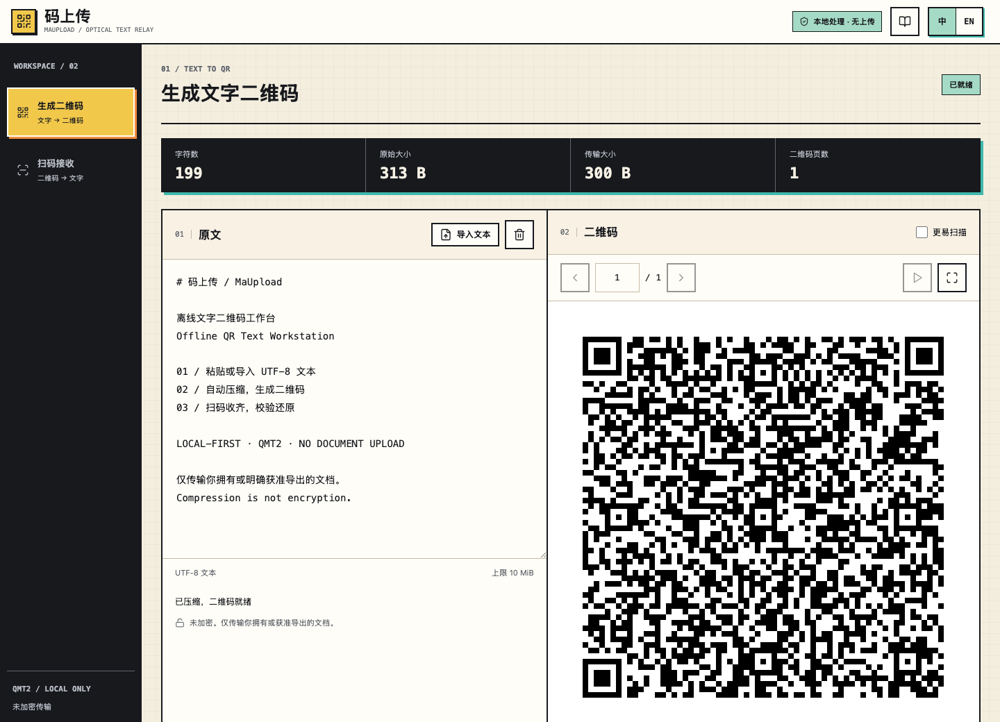

# 码上传 / MaUpload

**把文字装进二维码，让文档走光路。**

`LOCAL-FIRST` · `OPTICAL TEXT RELAY` · `QMT2` · `中文 / ENGLISH`

码上传是面向**经授权的隔离环境文档转录**的文字二维码工作台。粘贴文字，自动压缩，按实际容量生成尽量少的二维码；另一台设备扫码收齐后，校验并还原原文。不需要账户、口令、云盘或文档上传服务。

暖白纸面、近黑控制台、金黄导航、橙色操作与青绿校验状态，组成克制的 Y2K / Warm Workstation 视觉语言。它是一张能工作的技术台，不是一页功能清单。

[打开工作台](https://patshin.github.io/qrmax-transfer/) · [图文使用手册](https://patshin.github.io/qrmax-transfer/guide.html?lang=zh) · [下载离线包](https://patshin.github.io/qrmax-transfer/maupload-offline.zip) · [English](README.en.md)



## 为谁而做

适合在组织批准的流程下转录内网中的操作说明、Markdown、配置片段、代码和纯文本记录，尤其是网络隔离、不能使用云端文件服务、但**允许屏幕展示与摄像头采集**的工作场景。

**“适用于严格环境”不等于“获准导出任何资料”。** 本工具不绕过 DLP、终端策略、摄像头限制或审批流程，不提供企业安全认证、权限控制或审计记录。使用前应由所在组织确认文档级别、接收设备、拍摄方式和保存位置是否合规。若公司禁止此类传输，请不要使用。

## 核心能力

| 环节 | 行为 |
| --- | --- |
| 输入 | 粘贴文字，或导入一个有效的 UTF-8 文本文件，最大 10 MiB |
| 压缩 | 整篇 raw DEFLATE；不能减小体积时自动采用原始字节 |
| 展示 | 默认静态单页；翻页、页码跳转、全屏与每秒一页的可选循环播放 |
| 接收 | 摄像头扫描或二维码图片导入；支持乱序、重复和缺页补传 |
| 还原 | 收齐后检查长度与 CRC32；仅校验通过的文档可以复制或下载 |
| 语言 | 中文与英文即时切换，不改变文档或接收进度，不保存语言偏好 |

## 五步使用

1. **输入。** 发送设备打开“生成二维码”，粘贴原文或点击“导入文本”。TXT、Markdown、CSV、JSON 和代码均可，但必须是 UTF-8；不提取 Word / PDF 内容。
2. **展示。** 自动计算完成后，先以静态二维码试扫。多页文档可以手动翻页、输入页码、全屏，或使用播放按钮循环展示。
3. **接收。** 接收设备打开同一工具的“扫码接收”，选择摄像头并开始扫描，或一次导入多张原始二维码图片。普通手机扫码应用不能直接还原 QMT2 文档。
4. **补页。** 未收齐时复制“缺失页码”，在发送端“补页”输入相同范围，例如 `2, 5-8`，播放这些页。“全部页”恢复完整播放列表。
5. **导出。** 显示“校验通过”后，复制全文或下载 `document.txt`。下载保留原始 UTF-8 字节，包括导入文件的 BOM、CRLF 和尾部空格；编辑导入文件后则以编辑区内容为准。

传输期间不要刷新页面。切换到另一个文档需要确认，清空会话也需要确认。两个设备的界面语言可以不同。

## 密度与扫描

默认以容量优先：QR Byte 模式，最高 Version 40，ECC L。每页自动选择能容纳数据的最小版本。Version 40-L 可装 **2,953 字节**，扣除 36 字节头部后，正文最多 **2,917 字节 / 页**。字节不等于中文字数，实际页数取决于 UTF-8 编码与压缩结果。

“更易扫描”改用最高 Version 30、ECC M，以更多页面换取更低密度和更强纠错。开启它会生成新的文档会话，应清空接收端后重新扫描。

- 先全屏显示，完整保留白色边缘，避免反光，保持对焦稳定。
- 小于 3 px / 模块时会提示扩大显示；二维码始终是纯黑白、整数像素与四模块静区。
- 自动播放默认一秒一页。若实际摄像头跟不上，暂停后手动翻页。
- 摄像头需要 HTTPS 或 localhost，以及浏览器与组织策略许可。图片导入无需摄像头权限，每张最多 32 MiB / 1600 万像素。
- 图片解码测试不等于物理摄像头验收。上线前应以目标屏幕、摄像头和真实文档完成端到端试传。

## 隐私与边界

**压缩不是加密，CRC32 不是身份认证。** 拍摄或保存二维码的人可以用兼容解码工具还原文档。二维码传输不能保证保密性、来源可信或抵抗主动篡改。

- 文档处理在当前浏览器内完成；没有上传接口、CDN、远程字体或统计服务。
- 文档与接收页只保存在内存，不写入 URL、localStorage、sessionStorage、IndexedDB 或控制台日志。刷新或关闭页面后会话丢失。
- 在线访问会请求 GitHub Pages 的静态文件，托管方可能记录正常的访问元数据；这不等于上传文档。对外部访问也有要求的环境，请使用经审批的本地离线包。
- 下载、剪贴板、截图与录像会在页面之外产生副本，应按公司的数据管理要求处理。本工具无法管理或删除这些副本。
- 旧加密文件协议已退出主界面，不兼容旧传输包。遗留模块不进入当前生产应用的依赖图。

## 真正离线运行

1. 在联网的合规设备下载 `maupload-offline.zip`，经组织批准后带入目标环境。
2. 解压，保持 `qrmax-transfer/` 内的文件和目录完整。
3. 在该文件夹的**父目录**启动已有的本地静态服务器，例如：

```bash
python3 -m http.server 8080 --bind 127.0.0.1
```

4. 打开 `http://127.0.0.1:8080/qrmax-transfer/`。两端均可使用各自的本机服务。运行不需要 npm 或互联网，但本机必须已有可用的静态服务器。

不要双击 HTML 文件，模块 Worker 需要 HTTP(S)。绑定 `127.0.0.1` 仅供本机使用，不开放局域网。已加载的在线工作台可断网继续处理；**没有 Service Worker，不承诺断网后重新打开远程网址**。

## 开发与部署

```bash
npm ci
npm test
npm run build
npm run dev
```

`npm run build` 生成静态站点 `dist/` 和离线包 `dist/maupload-offline.zip`。测试覆盖多语言文本、Unicode、换行、容量边界、缺页、重复、损坏、解压边界与真实 QR 像素解码。

GitHub Pages 使用 `.github/workflows/pages.yml`：推送 `main` / `master` 后运行测试、构建和静态部署。仓库 Pages 的发布源设为 **GitHub Actions**。仓库路径改变时同步调整 `vite.config.ts` 的 `base`。发布内容不包含浏览器中输入或接收的文档。

## QMT2 协议

每页是 36 字节二进制头部加正文切片，没有 Base64、JSON 或单独的元数据页。整数为大端序，协议页索引从 0 开始，界面从 1 开始。

| 字段 | 字节 |
| --- | ---: |
| `QMT2` 标识 / 版本 2 / 压缩标记 | 4 / 1 / 1 |
| 头部 CRC16 / 随机文档 ID | 2 / 8 |
| 页索引 / 总页数 | 2 / 2 |
| 原始长度 / 编码长度 | 4 / 4 |
| 原文 CRC32 / 页载荷 CRC32 | 4 / 4 |

压缩标记为 `0` 原文或 `1` raw DEFLATE。头部 CRC16 计算时该字段置零，采用 CCITT-FALSE；CRC32 为 IEEE。接收端检查页数、长度、校验和，并限制解压输出不超过 10 MiB。
